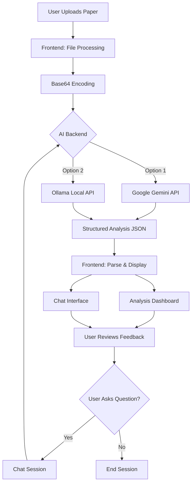

# SynthIE - Complete Deployment Guide

**An AI-Powered Research Paper Analysis Tool for Industrial Engineering**

> 📚 **Academic Purpose**: This application is designed for educational and research purposes to help students and researchers improve their Industrial Engineering papers through automated, criterion-based feedback.

---

## Table of Contents

1. [What is SynthIE?](#what-is-synthie)
2. [Application Architecture](#application-architecture)
3. [How It Works](#how-it-works)
4. [Deployment Options](#deployment-options)
5. [Option 1: Deploy with Google Cloud (Gemini)](#option-1-deploy-with-google-cloud-gemini)
6. [Option 2: Deploy Locally with Ollama](#option-2-deploy-locally-with-ollama)
7. [Using the Application](#using-the-application)
8. [Troubleshooting](#troubleshooting)
9. [FAQ](#faq)

---

## What is SynthIE?

**SynthIE** (Synthetic Industrial Engineering) is an automated editorial board that evaluates research papers against the "IE Gold Standard" - a comprehensive framework based on:

- **ABET** (Accreditation Board for Engineering and Technology) standards
- **IISE** (Institute of Industrial and Systems Engineers) criteria
- **ISO 9001** quality management principles
- **Six Sigma** and **Lean** methodologies
- **Operations Research** rigor
- **Industry 5.0** readiness

### Key Features

✅ **Automated Paper Analysis**: Upload a PDF or TXT file and receive detailed feedback  
✅ **Multi-Dimensional Scoring**: Evaluates papers across 4 core pillars (Math, Physical, Operational, Human)  
✅ **Section-by-Section Critique**: Detailed analysis of Abstract, Methodology, Results, etc.  
✅ **Interactive Chat**: Ask questions and get specific improvement suggestions  
✅ **Visual Dashboard**: See your scores and feedback in an intuitive interface

---

## Application Architecture

### System Hierarchy

```
SynthIE Application
│
├── Frontend Layer (React + TypeScript + Vite)
│   ├── User Interface Components
│   │   ├── File Upload Interface
│   │   ├── Analysis Dashboard
│   │   ├── Cluster Visualizer (4 Pillars)
│   │   ├── Chat Interface
│   │   └── Simulation Steps
│   │
│   └── State Management
│       ├── Document Context
│       ├── Analysis Results
│       └── Chat History
│
├── Service Layer
│   └── Gemini Service (AI Integration)
│       ├── Document Analysis
│       ├── Structured Output (JSON Schema)
│       └── Chat Session Management
│
└── AI Backend (Two Options)
    ├── Option A: Google Gemini API (Cloud)
    │   └── Model: gemini-3-pro-preview
    │
    └── Option B: Ollama (Local)
        └── Models: Llama 3.2, Gemma 2, DeepSeek R1
```

### The 4 Pillars Framework

SynthIE evaluates papers using four specialized "clusters" that represent different aspects of Industrial Engineering:

| Cluster | Name | Role | Evaluates |
|---------|------|------|-----------|
| **A** | Mathematical & Economic Core | The Solver | Operations Research, Engineering Economy, Mathematical Models |
| **B** | Physical & Production Core | The Builder | Manufacturing, Facilities, Quality & Reliability |
| **C** | Operational & Systemic Core | The Orchestrator | Supply Chain, Production Planning, System Integration |
| **D** | Human & Social Core | The Steward | Ergonomics, Safety, Management, Ethics |

### File Structure

```
synthie/
├── package.json                 # npm workspaces root (dev/build/typecheck scripts)
├── tsconfig.base.json           # Shared TypeScript settings
├── .env.example                 # Copy to .env.local (never committed)
│
├── apps/
│   ├── web/                     # React + Vite frontend
│   │   ├── index.html
│   │   ├── vite.config.ts       # Dev server, /api proxy, env loading
│   │   ├── tailwind.config.ts   # Tailwind theme (built at compile time)
│   │   └── src/
│   │       ├── index.tsx        # Entry point
│   │       ├── index.css        # Tailwind + global styles
│   │       ├── App.tsx          # Main application
│   │       ├── constants.tsx    # Cluster definitions
│   │       ├── components/      # AnalysisDashboard, ChatInterface, ...
│   │       └── api/client.ts    # Only route to the backend (no SDK, no key)
│   └── api/                     # Node backend: owns keys, prompts, model calls
│       └── src/
│           ├── server.ts        # Entry point
│           ├── config.ts        # Env validation (LLM_PROVIDER, keys, limits)
│           ├── http/            # Routes, validation, rate limit, error mapping
│           ├── services/        # reviewService, chatService
│           ├── prompts/         # Versioned prompts + analysis JSON Schema
│           └── llm/             # LlmProvider port + gemini / ollama adapters
│
└── packages/
    └── contracts/               # Shared domain types (ResearchAnalysis, ClusterId, ...)
        └── src/index.ts
```

---

## How It Works

### Step-by-Step Process

1. **Document Upload**
   - User uploads a research paper (PDF or TXT format)
   - File is converted to base64 encoding for API transmission

2. **Analysis Orchestration**
   ```
   Orchestrator → Review Board → 4 Clusters → Editor
   ```
   - **Orchestrator**: Parses document structure (sections, headings, content)
   - **Review Board**: Calculates initial metrics (word count, structure quality)
   - **4 Clusters**: Each evaluates the paper from their specialized perspective
   - **Editor**: Synthesizes feedback and generates actionable advice

3. **Structured Output Generation**
   - AI model returns JSON-formatted analysis following a strict schema
   - Includes: overall score, cluster scores, section analysis, writing style critique

4. **Interactive Refinement**
   - User can chat with the "Grand Council" to ask specific questions
   - AI maintains context of the original paper and analysis
   - Provides targeted suggestions for improvement

### Data Flow Diagram



---

## Deployment Options

You have **two main options** for deploying SynthIE:

| Option | Pros | Cons | Best For |
|--------|------|------|----------|
| **Google Cloud (Gemini)** | ✅ Most powerful AI<br>✅ No local hardware needed<br>✅ Always up-to-date | ❌ Requires Google Cloud account<br>❌ API costs (pay-per-use)<br>❌ Needs internet | Users who want the best quality and don't mind cloud costs |
| **Local (Ollama)** | ✅ Completely free<br>✅ Works offline<br>✅ Full data privacy | ❌ Requires good hardware<br>❌ Setup more complex<br>❌ Slightly lower quality | Users prioritizing privacy, offline access, or avoiding costs |

---

## 💰 Cost Estimation

### Google Cloud (Gemini 3 Pro Preview) Pricing

SynthIE uses **Gemini 3 Pro Preview** for the highest quality analysis. Here's the detailed pricing:

#### Official Pricing (as of February 2026)

| Usage Type | Free Tier | Paid Tier (per 1M tokens) |
|------------|-----------|---------------------------|
| **Input** | Not available | $2.00 (prompts ≤ 200k tokens)<br>$4.00 (prompts > 200k tokens) |
| **Output** (including thinking) | Not available | $12.00 (prompts ≤ 200k tokens)<br>$18.00 (prompts > 200k tokens) |
| **Context Caching** | Not available | $0.20 (storage)<br>$4.50/1M tokens/hour |

> 📊 **Source**: [Google AI Pricing](https://ai.google.dev/pricing)

#### What This Means for SynthIE Users

**Typical Usage Per Analysis:**

| Component | Tokens Used | Cost Calculation | Estimated Cost |
|-----------|-------------|------------------|----------------|
| **Input** (10-page paper) | ~5,000 tokens | 5,000 ÷ 1,000,000 × $2.00 | $0.01 |
| **Output** (detailed analysis) | ~3,000 tokens | 3,000 ÷ 1,000,000 × $12.00 | $0.036 |
| **Chat Messages** (5 follow-ups) | ~2,000 tokens | 2,000 ÷ 1,000,000 × $12.00 | $0.024 |
| **Total per paper** | ~10,000 tokens | - | **~$0.07** |

#### Real-World Cost Examples

| Scenario | Papers Analyzed | Total Cost | Notes |
|----------|----------------|------------|-------|
| **Single Student** | 5 papers/semester | **$0.35** | Negligible cost |
| **Graduate Student** | 20 papers/year | **$1.40** | Less than a coffee |
| **Research Group** | 100 papers/year | **$7.00** | Shared among team |
| **Heavy User** | 500 papers/year | **$35.00** | Still very affordable |

#### Free Credits

- **New Google Cloud users**: $300 in free credits (90 days)
- **Estimated analyses with free credits**: ~4,285 papers
- **Realistic usage**: Free credits will likely last years for academic use

#### Cost Comparison: Gemini vs Alternatives

| Service | Cost per Analysis | Quality | Notes |
|---------|------------------|---------|-------|
| **Gemini 3 Pro** | $0.07 | ⭐⭐⭐⭐⭐ | Best quality, used by SynthIE |
| **Gemini 3 Flash** | $0.02 | ⭐⭐⭐⭐ | Faster, slightly lower quality |
| **ChatGPT Plus** | $0.67 | ⭐⭐⭐⭐ | $20/month ÷ 30 analyses |
| **Claude Pro** | $0.67 | ⭐⭐⭐⭐ | $20/month ÷ 30 analyses |
| **Ollama (Local)** | $0.00 | ⭐⭐⭐⭐ | Free, requires hardware |

### Ollama (Local) Pricing

**Direct Costs**: $0.00 (completely free)

**Indirect Costs** (one-time hardware investment):

| Component | If You Need to Buy | If You Already Have |
|-----------|-------------------|---------------------|
| **Computer with 16GB RAM** | $500-$1,000 | $0 |
| **Electricity** (per analysis) | ~$0.001 | ~$0.001 |
| **Internet** (one-time download) | ~$0 (included in plan) | $0 |

**Break-Even Analysis:**
- If you analyze **more than 7,000 papers**, Ollama becomes cheaper than Gemini
- For typical academic use (5-50 papers/year), Gemini is more cost-effective
- For privacy-sensitive research, Ollama is invaluable regardless of cost

### Cost Optimization Tips

#### For Gemini Users

1. **Use Context Caching** (for repeated analyses):
   - Saves ~80% on input costs for similar papers
   - Automatically enabled in SynthIE

2. **Batch Processing**:
   - Analyze multiple papers in one session
   - Reduces overhead costs

3. **Monitor Usage**:
   - Check Google Cloud Console → Billing
   - Set up budget alerts (e.g., $10/month)

4. **Consider Gemini Flash** (if you modify the code):
   - 70% cheaper than Gemini Pro
   - Still excellent quality for most papers

#### For Ollama Users

1. **Choose the Right Model**:
   - Gemma 2 (2B): Fastest, lowest power consumption
   - Llama 3.2 (7B): Best quality-to-cost ratio
   - DeepSeek R1 (7B): Best for complex analysis

2. **Optimize Hardware**:
   - Use GPU if available (3x faster)
   - Close other applications during analysis
   - Run overnight for large batches

### Recommended Approach

| User Profile | Recommendation | Reasoning |
|--------------|---------------|-----------|
| **Undergraduate Student** | Gemini (free credits) | $300 credits = years of use |
| **Graduate Student** | Gemini (paid) | $1-2/year is negligible |
| **Professor/Researcher** | Gemini (paid) | Time saved > cost |
| **Privacy-Conscious** | Ollama | Data never leaves your machine |
| **No Internet Access** | Ollama | Only option for offline use |
| **Budget-Constrained Institution** | Ollama | One-time hardware investment |

### Cost Monitoring

**Set Up Billing Alerts in Google Cloud:**

1. Go to **Billing** → **Budgets & Alerts**
2. Create a budget:
   - Amount: $10/month (generous for academic use)
   - Alert at: 50%, 90%, 100%
3. You'll receive email notifications if costs approach limits

**Expected Monthly Costs:**
- **Light use** (1-5 papers): $0.07 - $0.35
- **Moderate use** (10-20 papers): $0.70 - $1.40
- **Heavy use** (50+ papers): $3.50+

> 💡 **Bottom Line**: For most academic users, Gemini costs less than $2/year, making it extremely affordable compared to the value provided.

---

## Option 1: Deploy with Google Cloud (Gemini)

### Prerequisites

Before starting, ensure you have:

- A computer with internet connection
- A Google account
- A credit/debit card (for Google Cloud billing, though you'll get free credits)

### Step 1: Set Up Google Cloud Account

#### 1.1 Create Google Cloud Account

1. Go to [Google Cloud Console](https://console.cloud.google.com/)
2. Click **"Get started for free"**
3. Sign in with your Google account
4. Follow the prompts to:
   - Enter your country
   - Agree to Terms of Service
   - Set up billing (you'll get **$300 in free credits** for 90 days)

> 💡 **Note**: You won't be charged unless you explicitly upgrade to a paid account.

#### 1.2 Create a New Project

1. In the Google Cloud Console, click the project dropdown (top left, next to "Google Cloud")
2. Click **"New Project"**
3. Enter a project name (e.g., `synthie-research-tool`)
4. Click **"Create"**
5. Wait for the project to be created (takes ~30 seconds)
6. Select your new project from the dropdown

### Step 2: Enable Gemini API

#### 2.1 Enable the Generative AI API

1. In the Google Cloud Console, open the **Navigation Menu** (☰ icon, top left)
2. Go to **"APIs & Services"** → **"Library"**
3. In the search bar, type: `Generative Language API`
4. Click on **"Generative Language API"**
5. Click **"Enable"**
6. Wait for the API to be enabled (~1 minute)

#### 2.2 Create an API Key

1. Go to **"APIs & Services"** → **"Credentials"**
2. Click **"+ Create Credentials"** → **"API Key"**
3. A dialog will appear with your API key (looks like: `AIzaSyD...`)
4. **IMPORTANT**: Copy this key immediately and save it somewhere safe
5. Click **"Restrict Key"** (recommended for security)
6. Under "API restrictions":
   - Select **"Restrict key"**
   - Choose **"Generative Language API"**
7. Click **"Save"**

> 🔒 **Security Tip**: Never share your API key publicly or commit it to GitHub!

### Step 3: Install Required Software

#### 3.1 Install Node.js

**For Windows:**
1. Go to [nodejs.org](https://nodejs.org/)
2. Download the **LTS version** (e.g., 20.x.x)
3. Run the installer
4. Follow the installation wizard (accept all defaults)
5. Verify installation:
   - Open **Command Prompt** (search "cmd" in Start menu)
   - Type: `node --version`
   - You should see something like `v20.11.0`

**For macOS:**
1. Go to [nodejs.org](https://nodejs.org/)
2. Download the **LTS version**
3. Run the `.pkg` installer
4. Follow the installation wizard
5. Verify installation:
   - Open **Terminal** (search "Terminal" in Spotlight)
   - Type: `node --version`

**For Linux (Ubuntu/Debian):**
```bash
# Update package list
sudo apt update

# Install Node.js
sudo apt install nodejs npm

# Verify installation
node --version
npm --version
```

### Step 4: Set Up the Application

#### 4.1 Download the Application

1. Download the `synthie` folder to your computer
2. Note the location (e.g., `C:\Users\YourName\Downloads\synthie` on Windows)

#### 4.2 Configure Environment Variables

1. Open the `synthie` folder
2. Copy `.env.example` to a new file named `.env.local` in the same folder
3. Open it with a text editor (Notepad on Windows, TextEdit on Mac)
4. Set your Gemini API key (it is used only by the API server, never sent to the browser):
   ```
   LLM_PROVIDER=gemini
   GEMINI_API_KEY=AIzaSyD...your-actual-key-here
   ```
5. Save the file

> ⚠️ **Important**: Make sure there are no spaces around the `=` sign!

#### 4.3 Install Dependencies

**For Windows:**
1. Open **Command Prompt**
2. Navigate to the synthie folder:
   ```cmd
   cd C:\Users\YourName\Downloads\synthie
   ```
3. Install dependencies:
   ```cmd
   npm install
   ```
4. Wait for installation to complete (~2-3 minutes)

**For macOS/Linux:**
1. Open **Terminal**
2. Navigate to the synthie folder:
   ```bash
   cd ~/Downloads/synthie
   ```
3. Install dependencies:
   ```bash
   npm install
   ```

### Step 5: Run the Application

#### 5.1 Start the Development Server

SynthIE has two parts that both need to run. In one Command Prompt or Terminal
(in the synthie folder), start the API server:

```bash
npm run dev:api
```

In a second terminal, start the web app:

```bash
npm run dev
```

You should see output like:

```
  VITE v6.2.0  ready in 500 ms

  ➜  Local:   http://localhost:3000/
  ➜  Network: http://192.168.1.100:3000/
```

#### 5.2 Access the Application

1. Open your web browser (Chrome, Firefox, Safari, Edge)
2. Go to: `http://localhost:3000`
3. You should see the SynthIE interface!

### Step 6: Test the Application

1. Click **"Click to upload document"**
2. Select a PDF or TXT research paper
3. (Optional) Add context in the "Review Context" field
4. Click **"Start Analysis"**
5. Wait for the analysis to complete (~30-60 seconds)
6. Review your results!

---

## Option 2: Deploy Locally with Ollama

This option allows you to run SynthIE completely offline using open-source AI models.

### Prerequisites

#### Hardware Requirements

| Component | Minimum | Recommended |
|-----------|---------|-------------|
| **RAM** | 16 GB | 32 GB |
| **Storage** | 20 GB free | 50 GB free |
| **CPU** | Intel i5 / AMD Ryzen 5 | Intel i7 / AMD Ryzen 7 |
| **GPU** (Optional) | - | NVIDIA RTX 3060+ |

> 💡 **Note**: You can run smaller models (like Gemma 2) with 8GB RAM, but performance will be slower.

### Step 1: Install Ollama

#### For macOS

1. Go to [ollama.com/download](https://ollama.com/download)
2. Click **"Download for macOS"**
3. Open the downloaded `.dmg` file
4. Drag **Ollama** to your Applications folder
5. Open **Ollama** from Applications
6. Verify installation:
   ```bash
   ollama --version
   ```

#### For Windows

1. Go to [ollama.com/download](https://ollama.com/download)
2. Click **"Download for Windows"**
3. Run the installer (`.exe` file)
4. Follow the installation wizard
5. Verify installation:
   - Open **Command Prompt**
   - Type: `ollama --version`

#### For Linux

```bash
# Download and run the install script
curl -fsSL https://ollama.com/install.sh | sh

# Verify installation
ollama --version
```

### Step 2: Download an AI Model

Ollama supports several models. Here are the recommended options:

#### Option A: Llama 3.2 (Best Quality, Requires 16GB+ RAM)

```bash
ollama pull llama3.2
```

#### Option B: Gemma 2 (Lightweight, Works with 8GB RAM)

```bash
ollama pull gemma2
```

#### Option C: DeepSeek R1 (Cost-Effective, Good for Complex Queries)

```bash
ollama pull deepseek-r1
```

> ⏱️ **Download Time**: Depending on your internet speed, this can take 10-30 minutes.

### Step 3: Verify Ollama is Running

1. Check if Ollama API is accessible:
   - Open your browser
   - Go to: `http://localhost:11434`
   - You should see: `Ollama is running`

2. Test the model:
   ```bash
   ollama run llama3.2
   ```
   - Type a test prompt: `What is industrial engineering?`
   - Press Enter
   - You should get a response
   - Type `/exit` to quit

### Step 4: Configure SynthIE for Ollama

No code changes are needed. In `.env.local` at the root of the synthie folder, set:

```
LLM_PROVIDER=ollama
LLM_MODEL=llama3.2
```

Optional: `OLLAMA_BASE_URL` (default `http://localhost:11434`) and `OLLAMA_NUM_CTX`
(default `32768`) for longer papers. See [SWITCHING_GUIDE.md](./SWITCHING_GUIDE.md).

### Step 5: Install Dependencies and Run

```bash
npm install

# Terminal 1: API server (talks to Ollama)
npm run dev:api

# Terminal 2: web app
npm run dev
```

### Step 7: Test with Ollama

1. Open browser: `http://localhost:3000`
2. Upload a TXT or PDF file (PDF text is extracted on the server)
3. Click "Start Analysis"
4. Wait for analysis (may take 1-3 minutes with Ollama)

---

## Using the Application

### Uploading a Document

1. **Supported Formats**: PDF or TXT (up to 10MB)
2. **Best Practices**:
   - Use well-formatted documents
   - Include clear section headings
   - Ensure text is readable (not scanned images)

### Understanding Your Results

#### Overall Score

- **90-100**: Publication-ready (Q1 journal quality)
- **80-89**: Strong paper, minor revisions needed
- **70-79**: Good foundation, major revisions required
- **60-69**: Significant improvements needed
- **Below 60**: Fundamental issues to address

#### Cluster Scores

Each of the 4 pillars provides a specialized evaluation:

- **Cluster A (Math/Econ)**: Are your models rigorous? Is the math correct?
- **Cluster B (Physical)**: Is your manufacturing/production analysis realistic?
- **Cluster C (Operational)**: Does your system integration make sense?
- **Cluster D (Human/Social)**: Have you considered human factors and ethics?

#### Section Analysis

Review each section (Abstract, Methodology, Results, etc.) for:
- ✅ **Strengths**: What you did well
- ❌ **Weaknesses**: What needs improvement
- 💡 **Advice**: Specific, actionable recommendations

### Using the Chat Interface

After receiving your analysis, you can ask questions like:

- "How can I improve my methodology section?"
- "What specific references should I add for Cluster A?"
- "Can you suggest a better way to present my results?"
- "Is my abstract too long?"

---

## Troubleshooting

### Google Cloud (Gemini) Issues

#### Error: "API key not valid"

**Solution**:
1. Check that your API key is correctly copied in `.env.local`
2. Ensure there are no extra spaces
3. Verify the API is enabled in Google Cloud Console
4. Try creating a new API key

#### Error: "Quota exceeded"

**Solution**:
1. Check your Google Cloud billing
2. You may have exceeded free tier limits
3. Enable billing or wait for quota reset (usually 24 hours)

#### Error: "Failed to analyze draft"

**Solution**:
1. Check your internet connection
2. Verify the file is not corrupted
3. Try a smaller file
4. Check browser console for detailed errors (F12 → Console tab)

### Ollama Issues

#### Error: "Cannot connect to Ollama"

**Solution**:
1. Verify Ollama is running:
   ```bash
   ollama serve
   ```
2. Check `http://localhost:11434` in browser
3. Restart Ollama application

#### Error: "Model not found"

**Solution**:
1. Verify you've downloaded the model:
   ```bash
   ollama list
   ```
2. If not listed, download again:
   ```bash
   ollama pull llama3.2
   ```

#### Slow Performance

**Solution**:
1. Use a smaller model (Gemma 2 instead of Llama 3.2)
2. Close other applications to free RAM
3. If you have an NVIDIA GPU, ensure Ollama is using it:
   ```bash
   ollama run llama3.2 --gpu
   ```

### General Issues

#### Application won't start

**Solution**:
1. Delete `node_modules` folder
2. Run `npm install` again
3. Check Node.js version: `node --version` (should be 18+)

#### Port 3000 already in use

**Solution**:
1. Edit `apps/web/vite.config.ts`
2. Change port number:
   ```typescript
   server: {
     port: 3001, // Change to any available port
   }
   ```

---

## FAQ

### General Questions

**Q: Is this application free to use?**  
A: The application itself is free. However:
- Google Cloud (Gemini): You get $300 in free credits, then pay-per-use
- Ollama: Completely free, but requires your own hardware

**Q: Can I use this for commercial purposes?**  
A: This application is designed for academic/educational use. Check the license terms of the AI models you use (Gemini, Llama, etc.) for commercial restrictions.

**Q: How accurate is the analysis?**  
A: The analysis is AI-generated and should be used as a guide, not absolute truth. Always apply critical thinking and consult with human advisors/professors.

**Q: Can I analyze papers in languages other than English?**  
A: Both Gemini and Llama support multiple languages, but results may vary. English provides the best accuracy.

### Technical Questions

**Q: Can I deploy this to a web server?**  
A: Yes! You can deploy to:
- Google Cloud Run
- AWS Amplify
- Vercel
- Netlify

For production deployment, you'll need to:
1. Build the application: `npm run build`
2. Deploy the `dist` folder
3. Set environment variables on your hosting platform

**Q: How do I update the AI model?**  
A: 
- **Gemini**: Automatically updated by Google
- **Ollama**: Run `ollama pull <model-name>` to get the latest version

**Q: Can I use multiple models with Ollama?**  
A: Yes! Download multiple models and switch between them by changing `LLM_MODEL` in `.env.local` and restarting `npm run dev:api`.

**Q: How much does Gemini API cost?**  
A: As of 2026, Gemini pricing is approximately:
- Free tier: First 60 requests/minute
- Paid: ~$0.001 per 1K characters

Check [Google Cloud Pricing](https://cloud.google.com/vertex-ai/pricing) for current rates.

### Privacy & Security

**Q: Is my research paper data secure?**  
A: 
- **Gemini**: Data is sent to Google Cloud. Review [Google's privacy policy](https://cloud.google.com/terms/cloud-privacy-notice)
- **Ollama**: Data never leaves your computer - completely private

**Q: Can I use this for confidential research?**  
A: Use Ollama for maximum privacy. Avoid uploading confidential data to cloud services.

**Q: Where is my data stored?**  
A: 
- **Gemini**: Temporarily processed by Google (not stored long-term)
- **Ollama**: Only on your local machine

---

## Support & Contribution

### Getting Help

If you encounter issues:

1. Check the [Troubleshooting](#troubleshooting) section
2. Review error messages in the browser console (F12)
3. Check Ollama logs: `ollama logs`

### Academic Citation

If you use SynthIE in your research, please cite:

```
Castaneda, B., & Polanco, J. (2026). SynthIE: An AI-Powered Research Analysis Tool 
for Industrial Engineering Education. 
```

---

## Credits

**Developed by**: Brigitte Castaneda and Jaime Polanco  
**Purpose**: Academic tool for Industrial Engineering research improvement  
**License**: Educational use  
**AI Models**: Google Gemini, Meta Llama, Google Gemma, DeepSeek

---

## Appendix: Model Comparison

| Model | Provider | Size | RAM Required | Speed | Quality | Cost |
|-------|----------|------|--------------|-------|---------|------|
| **Gemini 3 Pro** | Google | N/A (Cloud) | N/A | ⚡⚡⚡ Fast | ⭐⭐⭐⭐⭐ Excellent | 💰 Pay-per-use |
| **Llama 3.2** | Meta (Ollama) | 7B | 16 GB | ⚡⚡ Medium | ⭐⭐⭐⭐ Very Good | Free |
| **Gemma 2** | Google (Ollama) | 2B | 8 GB | ⚡⚡⚡ Fast | ⭐⭐⭐ Good | Free |
| **DeepSeek R1** | DeepSeek (Ollama) | 7B | 16 GB | ⚡⚡ Medium | ⭐⭐⭐⭐ Very Good | Free |

### Recommendations

- **Best Overall**: Gemini 3 Pro (if you have Google Cloud credits)
- **Best for Privacy**: Llama 3.2 with Ollama
- **Best for Low-End Hardware**: Gemma 2
- **Best for Complex Analysis**: DeepSeek R1

---

**Last Updated**: February 2026  
**Version**: 1.0.0
