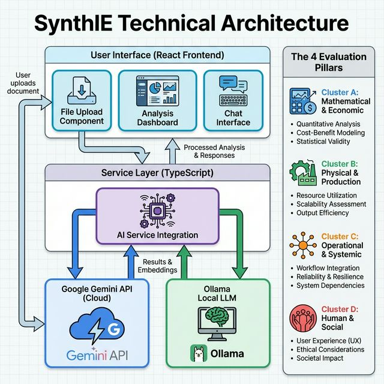

# 📚 SynthIE Documentation Index

Welcome to the SynthIE documentation! This index helps you find the right guide for your needs.

---

## 🚀 Quick Start

**New to SynthIE?** Start here:

1. **[README.md](./README.md)** - Quick overview and 5-minute setup
2. **[DEPLOYMENT_GUIDE.md](./DEPLOYMENT_GUIDE.md)** - Complete step-by-step deployment

---

## 📖 Documentation Files

### Main Documentation

| File | Purpose | Who Should Read |
|------|---------|-----------------|
| **[README.md](./README.md)** | Quick start guide, architecture overview | Everyone |
| **[DEPLOYMENT_GUIDE.md](./DEPLOYMENT_GUIDE.md)** | Comprehensive deployment instructions | First-time deployers |
| **[SWITCHING_GUIDE.md](./SWITCHING_GUIDE.md)** | How to switch between Gemini and Ollama | Users wanting to try both options |

### Technical Files

| File | Purpose | Who Should Read |
|------|---------|-----------------|
| **[services/geminiService.ts](./services/geminiService.ts)** | Google Gemini integration (default) | Developers |
| **[services/geminiService.ollama.ts](./services/geminiService.ollama.ts)** | Ollama integration (alternative) | Users deploying locally |
| **[architecture_diagram.png](./architecture_diagram.png)** | Visual system architecture | Everyone |

---

## 🎯 Choose Your Path

### I want to deploy with Google Cloud (Gemini)

1. Read: [DEPLOYMENT_GUIDE.md - Option 1](./DEPLOYMENT_GUIDE.md#option-1-deploy-with-google-cloud-gemini)
2. Follow steps 1-6
3. Estimated time: **15-20 minutes**

**Requirements:**
- Google Cloud account
- Credit card (for free $300 credits)
- Internet connection

---

### I want to deploy locally (Ollama)

1. Read: [DEPLOYMENT_GUIDE.md - Option 2](./DEPLOYMENT_GUIDE.md#option-2-deploy-locally-with-ollama)
2. Follow steps 1-7
3. Estimated time: **30-45 minutes**

**Requirements:**
- 16GB+ RAM (8GB for Gemma 2)
- 20GB+ free storage
- No internet needed after setup

---

### I want to understand the architecture first

1. View: [architecture_diagram.png](./architecture_diagram.png)
2. Read: [README.md - Architecture Overview](./README.md#architecture-overview)
3. Review: [DEPLOYMENT_GUIDE.md - How It Works](./DEPLOYMENT_GUIDE.md#how-it-works)

---

### I want to switch between Gemini and Ollama

1. Read: [SWITCHING_GUIDE.md](./SWITCHING_GUIDE.md)
2. Follow the switching instructions
3. Estimated time: **5 minutes**

---

## 🔍 Find Answers

### Common Questions

| Question | Answer Location |
|----------|----------------|
| How much does it cost? | [DEPLOYMENT_GUIDE.md - FAQ](./DEPLOYMENT_GUIDE.md#faq) |
| Is my data private? | [DEPLOYMENT_GUIDE.md - Privacy & Security](./DEPLOYMENT_GUIDE.md#privacy--security) |
| What are the hardware requirements? | [DEPLOYMENT_GUIDE.md - Prerequisites](./DEPLOYMENT_GUIDE.md#prerequisites) |
| How do I troubleshoot errors? | [DEPLOYMENT_GUIDE.md - Troubleshooting](./DEPLOYMENT_GUIDE.md#troubleshooting) |
| Can I use this offline? | Yes, with Ollama - see [Option 2](./DEPLOYMENT_GUIDE.md#option-2-deploy-locally-with-ollama) |

---

## 📊 Architecture Overview



### System Layers

1. **Frontend Layer** (React + TypeScript)
   - File upload interface
   - Analysis dashboard
   - Interactive chat

2. **Service Layer** (TypeScript)
   - AI integration
   - Request/response handling

3. **AI Backend** (Choose one)
   - **Option A**: Google Gemini API (cloud)
   - **Option B**: Ollama (local)

### The 4 Evaluation Pillars

- **Cluster A**: Mathematical & Economic Core
- **Cluster B**: Physical & Production Core
- **Cluster C**: Operational & Systemic Core
- **Cluster D**: Human & Social Core

---

## 🛠️ For Developers

### File Structure
```
synthie/
├── README.md                          # Quick start
├── DEPLOYMENT_GUIDE.md                # Full deployment guide
├── SWITCHING_GUIDE.md                 # Backend switching guide
├── DOCUMENTATION_INDEX.md             # This file
├── architecture_diagram.png           # System architecture
│
├── App.tsx                            # Main application
├── components/                        # React components
│   ├── AnalysisDashboard.tsx
│   ├── ChatInterface.tsx
│   ├── ClusterVisualizer.tsx
│   └── SimulationStep.tsx
│
├── services/                          # Business logic
│   ├── geminiService.ts               # Gemini integration (active)
│   └── geminiService.ollama.ts        # Ollama integration (reference)
│
├── types.ts                           # TypeScript types
├── constants.tsx                      # App constants
└── .env.local                         # Environment variables
```

### Key Technologies
- **Frontend**: React 19, TypeScript, Vite
- **AI**: Google Generative AI SDK / Ollama API
- **Styling**: Inline Tailwind-style classes
- **Icons**: Lucide React

---

## 📝 Academic Use

### Citation
```
Castaneda, B., & Polanco, J. (2026). SynthIE: An AI-Powered Research 
Analysis Tool for Industrial Engineering Education.
```

### Ethical Guidelines
✅ Use for feedback and improvement  
✅ Cite AI assistance in acknowledgments  
❌ Don't use to generate entire papers  
❌ Don't submit AI content as your own  

---

## 🆘 Getting Help

### Troubleshooting Steps

1. **Check the relevant guide:**
   - Gemini issues → [DEPLOYMENT_GUIDE.md - Troubleshooting](./DEPLOYMENT_GUIDE.md#troubleshooting)
   - Ollama issues → [SWITCHING_GUIDE.md - Troubleshooting](./SWITCHING_GUIDE.md#troubleshooting-ollama)

2. **Check browser console:**
   - Press F12 → Console tab
   - Look for error messages

3. **Check terminal output:**
   - Look for errors in the terminal where you ran `npm run dev`

4. **Verify prerequisites:**
   - Node.js installed: `node --version`
   - Dependencies installed: `npm install`
   - Ollama running (if using): `curl http://localhost:11434`

---

## 🎓 Learning Resources

### Understanding the Code

| Component | File | Purpose |
|-----------|------|---------|
| Main App | `App.tsx` | Application logic, state management |
| Analysis Display | `components/AnalysisDashboard.tsx` | Shows results |
| Chat | `components/ChatInterface.tsx` | Interactive Q&A |
| AI Service | `services/geminiService.ts` | AI integration |

### Understanding the AI

- **Gemini**: Google's most advanced AI model
- **Llama 3.2**: Meta's open-source model (7B parameters)
- **Gemma 2**: Google's lightweight model (2B parameters)
- **DeepSeek R1**: Cost-effective reasoning model

---

## 📞 Support

**Developed by**: Brigitte Castaneda and Jaime Polanco  
**Purpose**: Academic tool for Industrial Engineering research  
**Version**: 1.0.0  
**Last Updated**: February 2026

---

## ✅ Quick Checklist

Before deploying, make sure you have:

### For Gemini Deployment
- [ ] Node.js installed
- [ ] Google Cloud account created
- [ ] Gemini API enabled
- [ ] API key added to `.env.local`
- [ ] Dependencies installed (`npm install`)

### For Ollama Deployment
- [ ] Node.js installed
- [ ] Ollama installed
- [ ] Model downloaded (`ollama pull llama3.2`)
- [ ] Service file replaced
- [ ] Ollama running (`ollama serve`)
- [ ] Dependencies installed (`npm install`)

---

**Ready to start?** Go to [README.md](./README.md) for quick start or [DEPLOYMENT_GUIDE.md](./DEPLOYMENT_GUIDE.md) for detailed instructions!
